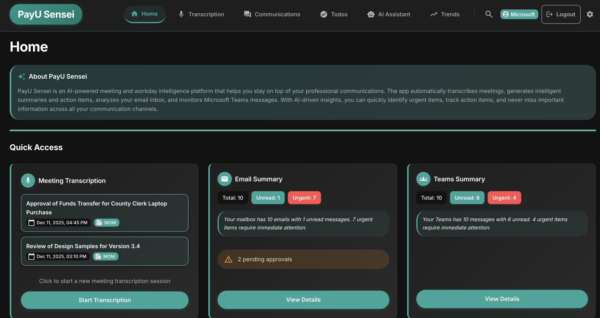

# PayU Sensei - Meeting Assistant

<div align="center">


**An intelligent full-stack application that transforms your meetings and workday with AI-powered transcription, automatic MOM generation, and cognitive email/Teams assistance.**

[Features](#-features) • [Quick Start](#-quick-start) • [Documentation](#-documentation) • [API Reference](#-api-reference) • [Contributing](#-contributing)

</div>

<div align="center">



</div>

---

## 🎯 Overview

PayU Sensei is a comprehensive AI-powered assistant designed to enhance productivity in modern work environments. It combines real-time meeting transcription, intelligent document generation, and proactive email/Teams management to help professionals stay organized and focused.

### Key Capabilities

- **🎤 Real-time Audio Transcription** - Capture and transcribe audio from any meeting platform (Zoom, Google Meet, Microsoft Teams)
- **📝 Automatic MOM Generation** - Generate structured minutes of meeting with decisions, action items, and key takeaways
- **🤖 AI-Powered Insights** - Get FAQs, follow-up email suggestions, and risk detection
- **📧 Email & Teams Integration** - Summarize inbox, detect urgent tasks, and suggest intelligent replies
- **📊 Live Dashboard** - Real-time view of transcript and AI-generated insights
- **🔒 Privacy Mode** - Option for local-only processing without cloud dependencies

---

## ✨ Features

### Meeting Intelligence
- **Multi-platform Support**: Works with Zoom, Google Meet, Microsoft Teams, and any audio source
- **Real-time Transcription**: Live transcription with speaker diarization using Whisper or Deepgram
- **Smart MOM Generation**: Automatically extracts decisions, action items, key points, and attendees
- **Meeting Insights**: Sentiment analysis, topic extraction, and engagement metrics
- **FAQ Generation**: Automatically generates frequently asked questions from meeting transcripts
- **Export Options**: Export transcripts and MOMs in multiple formats (PDF, DOCX, TXT, JSON)
- **Meeting History**: View and search through past meetings with full transcripts and summaries
- **Trend Analysis**: Analyze patterns across multiple meetings to identify recurring topics and decisions

### Email Intelligence
- **Inbox Summarization**: Get AI-powered summaries of your email inbox with key highlights
- **Urgency Detection**: Automatically identify and prioritize urgent emails requiring immediate attention
- **Email Categorization**: Classify emails as urgent, action required, informational, or low priority
- **Sentiment Analysis**: Detect frustration, urgency, and emotional tone in emails
- **Priority Scoring**: AI-powered priority ranking (0-100) based on content, sender, and context
- **Action Item Extraction**: Automatically extract tasks, deadlines, and owners from emails
- **Smart Reply Suggestions**: Generate context-aware, professional email responses
- **Email Draft Generation**: Create polished email drafts with proper tone and structure

### Teams Intelligence
- **Conversation Summarization**: Generate thread-level summaries of Teams conversations
- **Channel Activity Analysis**: Identify active discussions, blockers, and important topics
- **@Mention Analysis**: Track who needs responses and prioritize mentions
- **Response Suggestions**: Get AI-suggested polished responses for Teams messages
- **Cross-platform Correlation**: Link Teams discussions to related emails and meetings
- **Message Fetching**: Access Teams chats and channel messages via Microsoft Graph API

### Todo Management
- **Smart Todo Extraction**: Automatically create todos from meetings, emails, and Teams messages
- **Priority Management**: Organize todos with critical, high, medium, and low priorities
- **Drag & Drop Reordering**: Reorder todos within the same priority level
- **Source Tracking**: Track where each todo originated (meeting, email, teams, manual)
- **Completion Tracking**: Mark todos as complete with automatic timestamp tracking
- **Filtering & Sorting**: Filter by completion status, priority, and source type

### AI Assistant & Search
- **Contextual Chat Assistant**: AI assistant that understands your meetings, emails, Teams, and todos
- **Global Search**: Search across meetings, todos, emails, and Teams messages with snippet highlighting
- **Semantic Search**: AI-powered semantic search for finding relevant content by meaning
- **Cross-platform Context**: Assistant has access to all your data for comprehensive answers

### Unified Insights
- **Daily Digest**: AI-generated daily summary combining emails, Teams activity, todos, and meetings
- **Smart Notifications**: Only receive notifications for truly important items
- **Deadline Risk Prediction**: AI-powered prediction of deadline risks based on todos and communications
- **Trend Analysis**: Analyze patterns and trends across multiple meetings
- **Meeting Insights**: Sentiment, topics, engagement metrics, and key discussion points

### Communication Enhancement
- **Tone Optimization**: Optimize communication tone for target audience (professional, casual, formal)
- **Jira Integration**: Convert text into properly formatted Jira issues
- **Confluence Integration**: Convert text into Confluence page format
- **Professional Drafts**: Generate professional email and Teams message drafts

### Authentication & Security
- **Microsoft OAuth**: Secure authentication via Microsoft Azure AD
- **Token-based Auth**: Alternative token-based authentication for Graph Explorer
- **Privacy Mode**: Option for local-only processing without cloud dependencies

---

## 🛠️ Tech Stack

### Backend
- **Framework**: FastAPI (Python 3.9+)
- **Database**: SQLite (with PostgreSQL support for production)
- **ORM**: SQLAlchemy (async)
- **Transcription**: 
  - Local: OpenAI Whisper (via faster-whisper)
  - Cloud: Deepgram API
- **AI Models**: 
  - OpenAI: GPT-4, GPT-4o, GPT-3.5-turbo
  - AWS Bedrock: Claude (Sonnet, Haiku), Llama 3, Amazon Titan
- **Integrations**: 
  - Microsoft Graph API (Teams/Outlook)
  - OAuth 2.0 authentication
- **Real-time**: WebSockets for live transcription
- **Logging**: Structured logging with correlation IDs

### Frontend
- **Framework**: React 18
- **UI Library**: Material-UI (MUI) v5
- **Build Tool**: Vite
- **State Management**: React Hooks & Context API
- **Routing**: React Router v6
- **Charts**: Recharts
- **Drag & Drop**: @dnd-kit (for todo reordering)
- **HTTP Client**: Axios
- **WebSocket**: Socket.io-client (for real-time transcription)
- **Theme**: Dark/Light mode support with Material-UI theming

### Infrastructure
- **Containerization**: Docker & Docker Compose
- **API Documentation**: FastAPI Swagger/OpenAPI
- **Real-time Communication**: WebSockets

---

## 📁 Project Structure

```
hackathon/
├── backend/                          # FastAPI backend application
│   ├── app/
│   │   ├── api/                     # API route handlers
│   │   │   ├── transcription.py    # Transcription endpoints
│   │   │   ├── ai_processing.py    # Basic AI processing (MOM, FAQs)
│   │   │   ├── ai_enhanced.py       # Enhanced AI features (insights, trends, chat)
│   │   │   ├── email.py             # Email integration endpoints
│   │   │   ├── teams.py             # Teams integration endpoints
│   │   │   ├── todos.py             # Todo management endpoints
│   │   │   ├── search.py            # Global search endpoint
│   │   │   ├── export.py            # Export functionality
│   │   │   └── auth.py              # Authentication endpoints
│   │   ├── services/                # Business logic services
│   │   │   ├── transcription_service.py  # Audio transcription logic
│   │   │   ├── ai_service.py        # AI processing and analysis
│   │   │   └── bedrock_service.py  # AWS Bedrock integration
│   │   ├── integrations/            # Third-party integrations
│   │   │   ├── email_integration.py # Microsoft Outlook integration
│   │   │   └── teams_integration.py # Microsoft Teams integration
│   │   ├── models/                  # Data models and schemas
│   │   │   └── schemas.py           # Pydantic schemas
│   │   ├── utils/                   # Utility functions
│   │   │   └── logger.py             # Logging configuration
│   │   ├── database.py              # Database models and configuration
│   │   └── main.py                  # FastAPI application entry point
│   ├── requirements.txt             # Python dependencies
│   ├── Dockerfile                   # Backend container configuration
│   ├── env.example                  # Environment variables template
│   └── start.sh                     # Startup script
│
├── frontend/                        # React frontend application
│   ├── src/
│   │   ├── components/              # React components
│   │   │   ├── Home.jsx             # Dashboard/home page
│   │   │   ├── TranscriptionView.jsx # Meeting transcription interface
│   │   │   ├── EmailView.jsx        # Email inbox and analysis
│   │   │   ├── TeamsView.jsx        # Teams messages and analysis
│   │   │   ├── CommunicationsView.jsx # Unified communications view
│   │   │   ├── TodoView.jsx         # Todo management interface
│   │   │   ├── AIChatAssistant.jsx  # AI chat assistant
│   │   │   ├── TrendsView.jsx       # Meeting trends analysis
│   │   │   ├── OldMeetingsView.jsx  # Meeting history
│   │   │   ├── SearchBar.jsx        # Global search component
│   │   │   ├── DailyDigest.jsx      # Daily digest component
│   │   │   ├── SmartNotifications.jsx # Smart notifications
│   │   │   ├── DeadlineRisks.jsx    # Deadline risk prediction
│   │   │   ├── MeetingInsights.jsx  # Meeting insights visualization
│   │   │   ├── CrossPlatformCorrelation.jsx # Cross-platform correlation
│   │   │   ├── UtilityTools.jsx     # Jira/Confluence/Tone tools
│   │   │   └── ContextMenu.jsx      # Context menu component
│   │   ├── services/                # API client services
│   │   │   └── api.js               # Axios-based API client
│   │   ├── App.jsx                  # Main application component
│   │   ├── main.jsx                 # Application entry point
│   │   ├── theme.js                 # MUI theme configuration
│   │   └── ThemeContext.jsx         # Theme context provider
│   ├── package.json                 # Node.js dependencies
│   ├── Dockerfile                   # Frontend container configuration
│   ├── vite.config.js               # Vite configuration
│   └── start.sh                     # Startup script
│
├── docker-compose.yml               # Docker Compose configuration
├── .env.example                     # Environment variables template
├── README.md                        # This file
├── QUICKSTART.md                    # Quick start guide
├── SETUP.md                         # Detailed setup instructions
├── PROJECT_STRUCTURE.md             # Project structure documentation
├── FEATURE_STATUS.md                # Feature implementation status
├── FEATURE_ENHANCEMENTS.md          # Future enhancement ideas
├── AUDIO_SETUP.md                   # Audio capture setup guide
├── AWS_BEDROCK_SETUP.md             # AWS Bedrock integration guide
├── MICROSOFT_AUTH_SETUP.md          # Microsoft authentication setup
└── TEAMS_PERMISSIONS_TROUBLESHOOTING.md # Teams permissions guide
```

---

## 🚀 Quick Start

### Prerequisites

- **Python** 3.9 or higher
- **Node.js** 16 or higher
- **Docker** and Docker Compose (optional, for containerized deployment)
- **FFmpeg** (for audio processing)

### Option 1: Docker (Recommended)

```bash
# 1. Clone the repository
git clone https://github.com/ShubhGar/PayU-Sensei.git
cd PayU-Sensei

# 2. Create environment file
cp .env.example .env

# 3. Add your API keys to .env
# OPENAI_API_KEY=sk-your-key-here
# DEEPGRAM_API_KEY=your-deepgram-key (optional)

# 4. Start services
docker-compose up --build

# 5. Access the application
# Frontend: http://localhost:3000
# Backend API: http://localhost:8000
# API Docs: http://localhost:8000/docs
```

### Option 2: Local Development

#### Backend Setup

```bash
cd backend

# Create virtual environment
python -m venv venv
source venv/bin/activate  # On Windows: venv\Scripts\activate

# Install dependencies
pip install -r requirements.txt

# Create .env file
cp env.example .env
# Edit .env with your API keys

# Start server
uvicorn app.main:app --reload
```

The API will be available at `http://localhost:8000`

#### Frontend Setup

```bash
cd frontend

# Install dependencies
npm install

# Start development server
npm run dev
```

The frontend will be available at `http://localhost:3000`

> 📖 For detailed setup instructions, see [SETUP.md](SETUP.md)  
> ⚡ For a quick 5-minute setup, see [QUICKSTART.md](QUICKSTART.md)

---

## ⚙️ Configuration

### Environment Variables

Copy `.env.example` to `.env` and configure the following:

#### Required
- `OPENAI_API_KEY` - Your OpenAI API key for AI processing (MOM generation, email summarization, etc.)

#### Optional
- `DEEPGRAM_API_KEY` - Deepgram API key for cloud transcription (defaults to local Whisper)
- `USE_DEEPGRAM` - Set to `"true"` to use Deepgram instead of local Whisper
- `LOCAL_WHISPER_MODEL` - Whisper model size: `base`, `small`, `medium`, `large` (default: `base`)
- `OPENAI_MODEL` - OpenAI model to use (default: `gpt-4o`)
- `OPENAI_FALLBACK_MODEL` - Fallback OpenAI model if primary model is unavailable (default: `gpt-3.5-turbo`)

#### AWS Bedrock (Alternative to OpenAI)
- `USE_BEDROCK` - Set to `"true"` to use AWS Bedrock instead of OpenAI
- `AWS_REGION` - AWS region for Bedrock (e.g., `us-east-1`)
- `AWS_ACCESS_KEY_ID` - AWS access key ID
- `AWS_SECRET_ACCESS_KEY` - AWS secret access key
- `BEDROCK_MODEL_ID` - Bedrock model ID (e.g., `anthropic.claude-3-sonnet-20240229-v1:0`)

> 📖 For detailed AWS Bedrock setup, see [AWS_BEDROCK_SETUP.md](AWS_BEDROCK_SETUP.md)

#### Microsoft Integration
- `MICROSOFT_CLIENT_ID` - Azure App Registration Client ID
- `MICROSOFT_CLIENT_SECRET` - Azure App Registration Client Secret
- `MICROSOFT_TENANT_ID` - Azure Tenant ID

> 📖 For detailed Microsoft authentication setup, see [MICROSOFT_AUTH_SETUP.md](MICROSOFT_AUTH_SETUP.md)  
> 🔧 For Teams permissions troubleshooting, see [TEAMS_PERMISSIONS_TROUBLESHOOTING.md](TEAMS_PERMISSIONS_TROUBLESHOOTING.md)

#### CORS Configuration
- `ALLOWED_ORIGINS` - Comma-separated list of allowed origins (default: `http://localhost:3000,http://localhost:5173`)

### Audio Capture Setup

For system audio capture (meeting transcription):

**macOS:**
```bash
brew install blackhole-2ch
# Configure Audio MIDI Setup to route system audio through BlackHole
```

**Windows:**
- Use WASAPI loopback device (PyAudio should detect automatically)

**Linux:**
- Use PulseAudio or ALSA loopback device

> 📖 For detailed audio setup, see [AUDIO_SETUP.md](AUDIO_SETUP.md)  
> 🤖 For AWS Bedrock integration, see [AWS_BEDROCK_SETUP.md](AWS_BEDROCK_SETUP.md)

---

## 📚 API Reference

### Core Endpoints

#### Transcription
- `POST /api/transcribe/start` - Start a new transcription session
- `POST /api/transcribe/stop` - Stop an active transcription session
- `GET /api/transcript/{session_id}` - Get transcript for a session
- `GET /api/transcribe/sessions` - List all transcription sessions
- `GET /api/transcribe/sessions/{session_id}` - Get detailed session information
- `WebSocket /ws/transcribe/{session_id}` - Real-time transcription stream

#### AI Processing (Basic)
- `POST /api/ai/summarize` - Generate MOM and insights from transcript
- `POST /api/ai/faqs` - Generate FAQs from transcript
- `POST /api/ai/followup` - Generate follow-up items

#### AI Processing (Enhanced)
- `POST /api/ai/meeting-insights/{session_id}` - Get AI-powered meeting insights (sentiment, topics, engagement)
- `POST /api/ai/categorize-email` - Categorize and prioritize an email
- `POST /api/ai/chat` - AI chat assistant with full context
- `GET /api/ai/trends` - Analyze trends across multiple meetings
- `POST /api/ai/semantic-search` - Perform semantic search across meetings, emails, and teams
- `POST /api/ai/email/sentiment` - Analyze email sentiment
- `POST /api/ai/email/priority-score` - Score email priority (0-100)
- `POST /api/ai/teams/conversation-summary` - Generate Teams conversation summary
- `POST /api/ai/teams/channel-activity` - Analyze Teams channel activity
- `POST /api/ai/teams/mentions` - Analyze @mentions in Teams messages
- `POST /api/ai/teams/suggest-response` - Suggest polished Teams responses
- `POST /api/ai/correlate` - Correlate Teams discussions with related emails
- `GET /api/ai/digest/daily` - Generate daily digest
- `GET /api/ai/risks/deadlines` - Predict deadline risks
- `POST /api/ai/convert/jira` - Convert text to Jira issue format
- `POST /api/ai/convert/confluence` - Convert text to Confluence page format
- `POST /api/ai/optimize-tone` - Optimize communication tone
- `GET /api/ai/notifications/smart` - Get smart notifications

#### Email Integration
- `GET /api/email/inbox` - Get email inbox summary
- `POST /api/email/analyze` - Analyze specific email
- `POST /api/email/suggest-reply` - Generate reply suggestions
- `GET /api/email/messages` - Get detailed email messages

#### Teams Integration
- `GET /api/teams/messages` - Get Teams messages
- `GET /api/teams/chats` - Get Teams chats
- `GET /api/teams/channels` - Get Teams channels
- `POST /api/teams/analyze` - Analyze Teams conversation

#### Todo Management
- `GET /api/todos` - List all todos (with optional filters)
- `POST /api/todos` - Create a new todo
- `GET /api/todos/{todo_id}` - Get a specific todo
- `PATCH /api/todos/{todo_id}` - Update a todo
- `DELETE /api/todos/{todo_id}` - Delete a todo
- `POST /api/todos/reorder` - Reorder todos within the same priority

#### Search
- `GET /api/search` - Global search across meetings, todos, emails, and teams

#### Export
- `POST /api/export/{format}` - Export transcript/MOM (formats: `pdf`, `docx`, `txt`, `json`)

#### Authentication
- `GET /api/auth/status` - Check authentication status
- `GET /api/auth/microsoft/login` - Get Microsoft OAuth login URL
- `GET /api/auth/microsoft/callback` - OAuth callback handler
- `POST /api/auth/token` - Set access token manually
- `POST /api/auth/logout` - Logout and clear session

### Interactive API Documentation

Once the backend is running, visit:
- **Swagger UI**: `http://localhost:8000/docs`
- **ReDoc**: `http://localhost:8000/redoc`

---

## 🧪 Testing

### Health Check

```bash
curl http://localhost:8000/health
```

### Start Transcription Session

```bash
curl -X POST http://localhost:8000/api/transcribe/start \
  -H "Content-Type: application/json" \
  -d '{"title": "Team Standup Meeting"}'
```

### Generate MOM

```bash
curl -X POST http://localhost:8000/api/ai/summarize \
  -H "Content-Type: application/json" \
  -d '{"session_id": "your-session-id"}'
```

### Get Daily Digest

```bash
curl http://localhost:8000/api/ai/digest/daily
```

### Search Across All Data

```bash
curl "http://localhost:8000/api/search?q=project%20deadline&limit=10"
```

### Get Smart Notifications

```bash
curl http://localhost:8000/api/ai/notifications/smart
```

---

## 🐛 Troubleshooting

### Backend Issues

**Server won't start?**
- Check Python version: `python --version` (need 3.9+)
- Verify port 8000 is available
- Check `.env` file exists and contains required keys
- Review backend logs for error messages

**Transcription not working?**
- Verify audio capture setup (see [AUDIO_SETUP.md](AUDIO_SETUP.md))
- Check microphone/system audio permissions
- For macOS: Ensure BlackHole is installed and configured
- Try using Deepgram API instead of local Whisper
- Check FFmpeg installation: `ffmpeg -version`

**AI processing errors?**
- Verify OpenAI API key is correct and has credits
- Check API quota/rate limits
- Review backend logs for detailed error messages

### Frontend Issues

**Frontend won't start?**
- Check Node version: `node --version` (need 16+)
- Delete `node_modules` and run `npm install` again
- Check if port 3000 is available (or 5173 for Vite default)
- Clear browser cache and try again
- Check for port conflicts: `lsof -i :3000` (macOS/Linux) or `netstat -ano | findstr :3000` (Windows)

**API connection errors?**
- Verify backend is running on port 8000
- Check CORS configuration in `.env` (ALLOWED_ORIGINS)
- Verify `VITE_API_URL` in frontend environment or `.env` file
- Check browser console for detailed error messages
- Ensure backend CORS middleware is properly configured

**Microsoft Authentication not working?**
- Verify Microsoft app registration is set up correctly
- Check redirect URIs match exactly (including trailing slashes)
- Ensure `MICROSOFT_CLIENT_ID`, `MICROSOFT_CLIENT_SECRET`, and `MICROSOFT_TENANT_ID` are set
- For token-based auth, get a fresh token from Graph Explorer
- Check token expiration (tokens expire after ~1 hour)

**Teams/Email integration not working?**
- Verify Microsoft authentication is successful
- Check required permissions are granted in Azure app registration:
  - `Mail.Read`, `Mail.ReadWrite`
  - `Chat.Read`, `Chat.ReadWrite`
  - `ChannelMessage.Read.All`
- Ensure token has not expired
- Check backend logs for detailed error messages
- See [TEAMS_PERMISSIONS_TROUBLESHOOTING.md](TEAMS_PERMISSIONS_TROUBLESHOOTING.md) for detailed help

### Database Issues

- Database file (`meetings.db`) is created automatically in the backend directory
- Check file permissions in project directory
- Delete `meetings.db` to reset database (all data will be lost)
- For production, consider migrating to PostgreSQL
- Database schema is automatically created on first run

### AI Processing Issues

**OpenAI API errors?**
- Verify `OPENAI_API_KEY` is set and valid
- Check API quota and rate limits
- Ensure sufficient credits in OpenAI account
- Try using fallback model if primary model is unavailable
- Review error messages in backend logs

**AWS Bedrock errors?**
- Verify AWS credentials are correct
- Check `AWS_REGION` matches your Bedrock service region
- Ensure Bedrock model access is enabled in AWS console
- Verify `BEDROCK_MODEL_ID` is correct for your region
- Check IAM permissions for Bedrock access

**Transcription errors?**
- For local Whisper: Ensure sufficient disk space and RAM
- For Deepgram: Verify `DEEPGRAM_API_KEY` is set
- Check audio input device permissions
- Verify FFmpeg is installed: `ffmpeg -version`
- On macOS, ensure BlackHole is properly configured

---

## 🚢 Deployment

### Production Considerations

1. **Database**: Use PostgreSQL instead of SQLite
2. **Environment**: Set `PRIVACY_MODE=true` for local-only processing
3. **Security**: 
   - Use HTTPS
   - Set up proper OAuth redirect URIs
   - Use environment-specific `.env` files
4. **Monitoring**: Set up logging and monitoring
5. **Scaling**: Consider using a reverse proxy (nginx) and load balancer

### Docker Production

```bash
# Build production images
docker-compose -f docker-compose.prod.yml build

# Run with production settings
docker-compose -f docker-compose.prod.yml up -d
```

---

## 🤝 Contributing

Contributions are welcome! Please feel free to submit a Pull Request.

1. Fork the repository
2. Create your feature branch (`git checkout -b feature/AmazingFeature`)
3. Commit your changes (`git commit -m 'Add some AmazingFeature'`)
4. Push to the branch (`git push origin feature/AmazingFeature`)
5. Open a Pull Request

---

## 📄 License

This project is licensed under the MIT License - see the LICENSE file for details.

---

## 🙏 Acknowledgments

- OpenAI for Whisper and GPT models
- Deepgram for transcription API
- FastAPI for the excellent web framework
- Material-UI for the beautiful component library
- All contributors and users of this project

---

## 📞 Support

For issues, questions, or contributions:
- Open an issue on [GitHub](https://github.com/ShubhGar/PayU-Sensei/issues)
- Check the [Documentation](https://github.com/ShubhGar/PayU-Sensei/wiki)

---

<div align="center">

**Made with ❤️ by the PayU Sensei Team**

[⭐ Star us on GitHub](https://github.com/ShubhGar/PayU-Sensei) • [🐛 Report Bug](https://github.com/ShubhGar/PayU-Sensei/issues) • [💡 Request Feature](https://github.com/ShubhGar/PayU-Sensei/issues)

</div>


